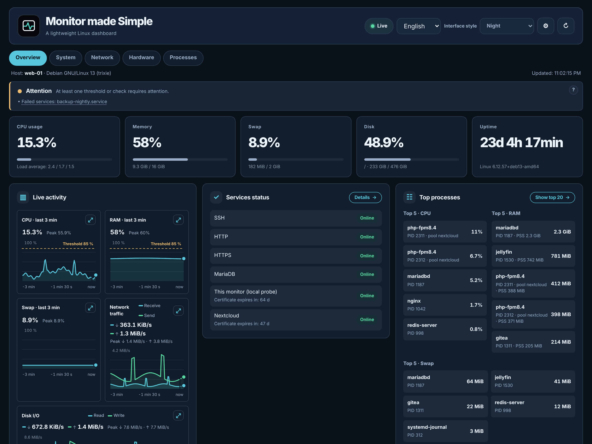

# Monitor made Simple

**A lightweight Linux monitoring dashboard in a single PHP file.** No database, no agent, no dependencies: drop `monitor.php` on your web server, set a password, and open it in your browser.

<br clear="left">



## Features

- **Overview**: a health banner with clickable alerts, CPU, memory, swap, disk and uptime, live charts, services status and top processes.
- **System**: OS and kernel, restart required, failed systemd services, pressure stall information (PSI).
- **Network**: interfaces (physical, virtual, VPN), listening ports and their exposure, TCP service checks, HTTP/HTTPS checks with certificate expiry.
- **Hardware**: CPUs, temperatures, graphics cards, filesystems, inodes and disk activity.
- **Processes**: top 20 by CPU, RAM and swap.
- 6 languages, 3 styles (Night, Dim, Light), and a JSON API at `monitor.php?api=stats`.

## Requirements

- A **Linux** server: metrics are read from `/proc` and `/sys` (Windows, macOS and BSD are not supported).
- **PHP 8.1+** with any web server. If `open_basedir` is set, allow `/proc` and `/sys`.

## Installation

1. Copy `monitor.php` to your web server (a less obvious name, such as `stats-4f7a.php`, makes it harder to find).
2. Create a password hash:
   ```bash
   php -r 'echo password_hash("your-password", PASSWORD_DEFAULT), PHP_EOL;'
   ```
3. Give it to the dashboard, preferably as the `ESM_PASSWORD_HASH` environment variable (PHP-FPM pool: `env[ESM_PASSWORD_HASH] = ...`), or in the constant of the same name at the top of the file. The default user is `admin`.
4. Open the page **over HTTPS** and log in.

If Apache with PHP-FPM keeps asking for the password, add `CGIPassAuth On` to the folder's configuration.

## Configuration

Settings are constants at the top of `monitor.php`: title, refresh interval, TCP services (`ESM_SERVICES`) and HTTP/HTTPS endpoints (`ESM_HTTP_CHECKS`) to check, remote mounts, and cache durations.

## Security

Authentication is mandatory, including for the API. The password is stored as a bcrypt hash only, the page uses a strict Content Security Policy, and the dashboard is read-only: it never changes anything on the server.

## License

[MIT](LICENSE) · If you find it useful, you can [buy me a coffee](https://www.buymeacoffee.com/fabricebreizh) ☕
